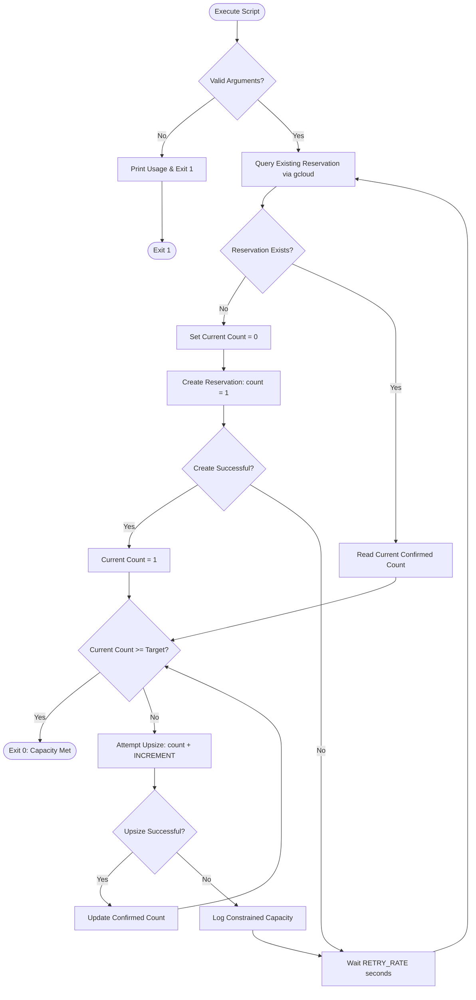

# GCP Retrying Reservations (`retrying-reservations.sh`)

An automated, resilient capacity acquisition script for **Google Cloud Compute Engine** zonal reservations. 

Progressively establishes and upsizes compute reservations in incremental steps (ratchet pattern) with automated backoff retries until the desired capacity is fully secured.

---

## Overview

In high-demand cloud regions and zones, provisioning large blocks of Compute Engine virtual machines or specialized GPU/accelerator instances in a single request frequently encounters capacity constraints (`ZONE_RESOURCE_POOL_EXHAUSTED`).

Google Cloud compute reservations are **all-or-nothing**: if you request 10 instances in a single batch and the zone currently only has capacity for 7, the entire reservation creation or update request is rejected, leaving you with 0 reserved instances.

`retrying-reservations.sh` overcomes this limitation by implementing an **incremental ratchet strategy**:
1. **Establishes a Beachhead**: First creates the reservation with a single instance (`vm-count=1`).
2. **Progressive Upsizing**: Repeatedly updates the reservation count in increments of 1 (or a configurable batch size), securing each instance as soon as capacity becomes available in the zone.
3. **Automated Retry Backoff**: When the zonal pool is constrained, the script gracefully pauses for a configured retry interval (`RETRY_RATE`, default 60 seconds) before re-attempting, avoiding aggressive API polling.
4. **Idempotent Continuation**: Detects existing reservations and resumes from the current confirmed count, allowing you to stop and restart the script at any time without losing secured capacity.

---

## Workflow Logic



---

## Key Capabilities

- **Incremental Capacity Ratchet**: Upsizes one instance at a time to lock in capacity incrementally rather than waiting for large contiguous availability.
- **State-Aware & Idempotent**: Inspects existing reservation status before initiating actions; safely resumes existing reservations without duplicate allocations.
- **Accelerator & GPU Compatible**: Transparently supports GPU attachments (e.g., NVIDIA H100, A100, L4, T4) via standard Compute Engine flags.
- **Automated Lifecycle Self-Deletion**: Accepts optional `--delete-at-time` flags to ensure reservations automatically deprovision at a predetermined time, eliminating accidental idle billing.
- **Configurable Runtime Parameters**: Adjust retry intervals (`RETRY_RATE`) and step sizes (`INCREMENT`) via environment variables without modifying the script.
- **Portable & Minimal**: Written in standard POSIX-compliant Bash with no external dependencies other than the `gcloud` CLI.

---

## Prerequisites

1. **Google Cloud SDK (`gcloud` CLI)**:
   Ensure `gcloud` is installed, updated, and authenticated.
   ```bash
   gcloud components update
   gcloud auth login
   ```

2. **Compute Engine API**:
   The Compute Engine API must be enabled in your target project:
   ```bash
   gcloud services enable compute.googleapis.com --project=YOUR_PROJECT_ID
   ```

3. **IAM Permissions**:
   The executing identity (user account or service account) requires the following permissions on the target project:
   - `compute.reservations.get`
   - `compute.reservations.list`
   - `compute.reservations.create`
   - `compute.reservations.update`

   Standard role: **Compute Instance Admin (v1)** (`roles/compute.instanceAdmin.v1`) or custom role with equivalent reservation permissions.

4. **Resource Quotas**:
   Ensure your project has sufficient Compute Engine CPU, GPU, and RAM quotas in the target region.

---

## Installation & Setup

Clone the repository and ensure the script is executable:

```bash
git clone https://github.com/brookswood/retrying_reservations.git
cd retrying_reservations
chmod +x retrying-reservations.sh
```

---

## Command Syntax

```bash
./retrying-reservations.sh <reservation-name> <project-id> <zone> <vm-type> <vm-count>
```

### Positional Arguments

| Argument | Description | Example |
| :--- | :--- | :--- |
| `<reservation-name>` | The name of the reservation to create or upsize. | `prod-ml-reservation` |
| `<project-id>` | The Google Cloud project ID hosting the reservation. | `my-gcp-project` |
| `<zone>` | The target Google Cloud zone where capacity is reserved. | `us-central1-a` |
| `<vm-type>` | Machine type specification, including optional supplementary flags. | `"n2-standard-8"` |
| `<vm-count>` | Total desired count of reserved virtual machines (positive integer). | `10` |

### Environment Variables

| Variable | Default | Description |
| :--- | :--- | :--- |
| `RETRY_RATE` | `60` | Number of seconds to wait before retrying after a failed upsize or create attempt. |
| `INCREMENT` | `1` | Number of instances to add per upsize attempt. |
| `GCLOUD_BIN` | `gcloud` | Custom path to the `gcloud` executable (if not in standard `PATH`). |

---

## Usage Examples

### 1. Standard Compute Engine VMs
Reserve 10 `n2-standard-8` instances in `us-central1-a`:

```bash
./retrying-reservations.sh my-reservation my-gcp-project us-central1-a "n2-standard-8" 10
```

### 2. GPU-Accelerated Instances
Reserve 4 `n1-standard-64` instances with 4x NVIDIA Tesla T4 GPUs attached to each:

```bash
./retrying-reservations.sh gpu-reservation my-gcp-project us-central1-a \
  "n1-standard-64 --accelerator=count=4,type=nvidia-tesla-t4" 4
```

### 3. Automated Self-Deletion (`--delete-at-time`)
Set an automated self-deletion timestamp so the reservation automatically terminates and stops billing at a specific UTC date and time:

```bash
./retrying-reservations.sh campaign-res my-gcp-project us-central1-a \
  "n2-standard-8 --delete-at-time=2026-12-31T23:59:00.000Z" 10
```

### 4. Custom Retry Interval and Batch Step
To poll every 30 seconds and increment by 2 instances at a time:

```bash
RETRY_RATE=30 INCREMENT=2 ./retrying-reservations.sh batch-res my-gcp-project us-central1-b "c3-standard-8" 20
```

### 5. Running Unattended in the Background
For large allocations across multiple hours or days, run the script within `nohup`, `tmux`, or `screen`:

```bash
nohup ./retrying-reservations.sh ml-gpu-pool my-gcp-project us-central1-a \
  "g2-standard-8 --accelerator=count=1,type=nvidia-l4" 16 > reservation_acquisition.log 2>&1 &
```

Monitor progress in real time:
```bash
tail -f reservation_acquisition.log
```

---

## Consuming Reserved Capacity

Once capacity has been acquired, compute instances consume the reservation according to their reservation affinity.

### Automatically Consuming Any Matching Reservation (Default)
By default, Compute Engine instances match any available reservation in the same zone matching their machine type:
```bash
gcloud compute instances create my-vm \
  --project=my-gcp-project \
  --zone=us-central1-a \
  --machine-type=n2-standard-8
```

### Targeting a Specific Reservation
To guarantee an instance binds to a specific named reservation:
```bash
gcloud compute instances create my-vm \
  --project=my-gcp-project \
  --zone=us-central1-a \
  --machine-type=n2-standard-8 \
  --reservation-affinity=specific \
  --reservation=my-reservation
```

---

## Managing & Inspecting Reservations

Inspect reservation status and confirmed count:
```bash
gcloud compute reservations describe my-reservation \
  --project=my-gcp-project \
  --zone=us-central1-a
```

List all reservations in a zone:
```bash
gcloud compute reservations list \
  --project=my-gcp-project \
  --filter="zone:(us-central1-a)"
```

Delete a reservation when no longer needed:
```bash
gcloud compute reservations delete my-reservation \
  --project=my-gcp-project \
  --zone=us-central1-a --quiet
```

---

## Operational Notes & Best Practices

- **Billing Notice**: Google Cloud bills for reserved capacity as long as the reservation exists, whether or not instances are currently attached. Use `--delete-at-time` or delete the reservation when your workload completes.
- **Stockouts vs Quotas**: If upsizing fails repeatedly, verify your regional CPU/GPU quotas via `gcloud compute project-info describe`. `ZONE_RESOURCE_POOL_EXHAUSTED` indicates temporary physical data center capacity constraints, whereas `QUOTA_EXCEEDED` indicates you must request a quota increase.
- **Single-Zone Scope**: Compute Engine reservations are strictly zonal. To hedge against zonal constraints, you can run separate instances of the script targeting different zones within the same region.

---

## References

- [Google Cloud Reservations Overview](https://cloud.google.com/compute/docs/instances/reservations-overview)
- [Creating and Modifying Reservations](https://cloud.google.com/compute/docs/instances/creating-reservations)
- [Consuming Reserved Instances](https://cloud.google.com/compute/docs/instances/reservations-consume)
- [gcloud compute reservations Reference](https://cloud.google.com/sdk/gcloud/reference/compute/reservations/)

---

## License

This project is licensed under the [Apache License 2.0](LICENSE).
